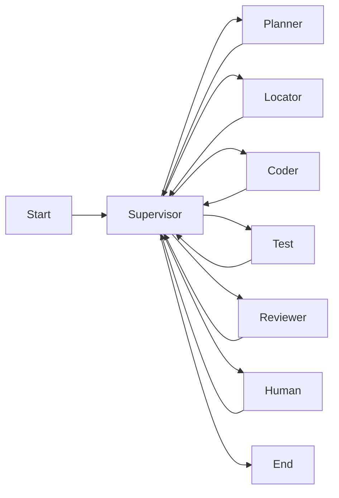

# 架构与关键约束

## 状态机

所有业务节点返回自己的字段更新，列表通过 reducer 追加；Supervisor 只做确定性路由、状态终止和重试计数。Single 跳过 Planner/Reviewer，无审核 Multi 跳过 Reviewer。补丁预校验拒绝、Test 失败或 Reviewer 拒绝共用 `max_retries` 预算，最多生成 `1 + max_retries` 个补丁。预校验拒绝不写文件、不运行未应用补丁的测试，将具体错误放入 patch_feedback 后交还 Coder。模型解析失败最多尝试两次，模型网络超时和 SDK 传输重试单独受限。

人工节点使用 `interrupt()`，审批用同一个 thread_id 和 `Command(resume=...)` 继续。依据官方 [LangGraph 中断说明](https://docs.langchain.com/oss/python/langgraph/interrupts)，节点从中断点所在节点的开头重放，因此 Human 在 interrupt 前没有外部副作用。

## 存储和恢复

`tasks.sqlite3` 记录 task_id、独立 thread_id 与初始输入；`checkpoints.sqlite3` 使用官方 SqliteSaver 存储每个节点状态。每个任务具有 baseline 和 workspace。baseline 是创建任务时的只读逻辑基线，原仓库不参与后续 Diff；工作副本只通过受控编辑器改变。任务文件锁串行化运行与审批。

Docker 不可用产生 `blocked` 及实际补丁。resume 从 Test 继续，不重新调模型或重复应用补丁。暂停审批可跨进程重启恢复。后台任务队列为单进程开发模式，重启后使用 resume；任意文件修改瞬间被杀进程的跨文件事务恢复尚未实现。

## 模型与工具边界

Model Protocol 接受 Schema/payload，返回 Pydantic 结果与真实计量。Live 使用 LangChain 结构化输出；Mock 是显式样例规则。Locator 将自然语言策略转换为有界关键词，优先检索 suspected_modules，再用关键词/AST 排名，读取前 12 个相关文件，上下文预算默认 24000 字符。Token 统计取自模型实际 usage，不用字符数伪装 Token；事件保留请求/响应模型标识与 provider response ID。

Repository 不导入目标代码。它提供受控相对路径、UTF-8 读取、字面搜索、AST 定义定位、依赖清单、Python 文本替换。MCP 服务以 [官方 Python SDK](https://github.com/modelcontextprotocol/python-sdk/tree/v1.x) FastMCP 标准传输公开只读能力；Graph 和 MCP 复用底层实现，适合独立测试。

## 执行边界

宿主机只运行自身服务与固定 Git/Docker 命令。所有目标仓库测试运行在非 root Docker 内。网络关闭，源码只读，根文件系统只读；临时文件放 tmpfs；仅独立临时 results 目录可写。测试命令由开发者固定，模型不能提供 shell。只使用维护者构建的镜像，运行时不安装仓库依赖。stdout/stderr 管道各只保留 20000 字节，其余持续丢弃，Docker 日志驱动关闭；结果目录磁盘配额仍是后续强化项。

Docker 的 JUnit 和退出码是测试证据，不是语义正确性的证明。Reviewer 检查原需求、Diff、测试；独立评测使用未提供给 Coder 的验收用例。当前三类 Bug 的评测先证明失败基线，再执行三模式修复，失败修复纳入成功率分母。27 次确定性运行只足以验证这些已知案例的运行路径，不代表真实 LLM 泛化能力。

## 审批与外部操作

进入人工节点前保存 Diff SHA-256；服务审批时重新计算当前 Diff，并要求客户端摘要一致。真正批准需要 `evidence=docker`，路由测试替身不具备批准资格。拒绝终止提交操作。GitHub 外部写入为独立的显式请求，必须同时验证批准状态、摘要、远端文件基线，并通过 SQLite publications 表防止重复建 PR。不确定的远端写入停止重试，交由用户检查。

GitHub 的 tree/commit/branch 和 PR 使用 [官方 Git Trees API](https://docs.github.com/en/rest/git/trees) 与 [Pull Requests API](https://docs.github.com/en/rest/pulls/pulls)。远端凭据存为 SecretStr，不进入任务状态；可选 Issue 导入只允许配置仓库下的标准 Issue URL。

基础威胁边界覆盖路径穿越、符号链接/junction/hardlink、敏感元目录、Windows ADS/设备名、模型任意 Shell、无 Docker 降级、重复并发、过期审批及浏览器跨站写入。生产多用户认证、恶意本机进程竞态、内核逃逸、资源配额与发布机制仍需后续强化。
